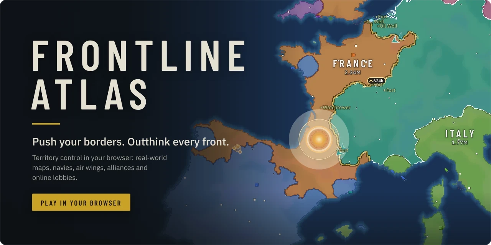
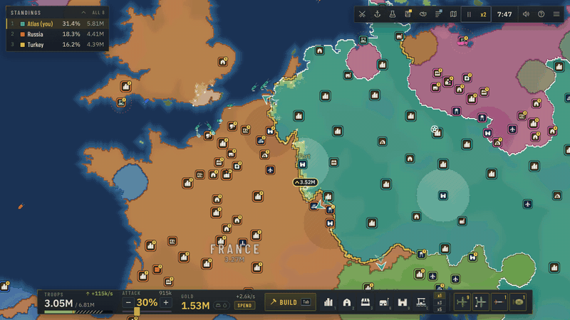
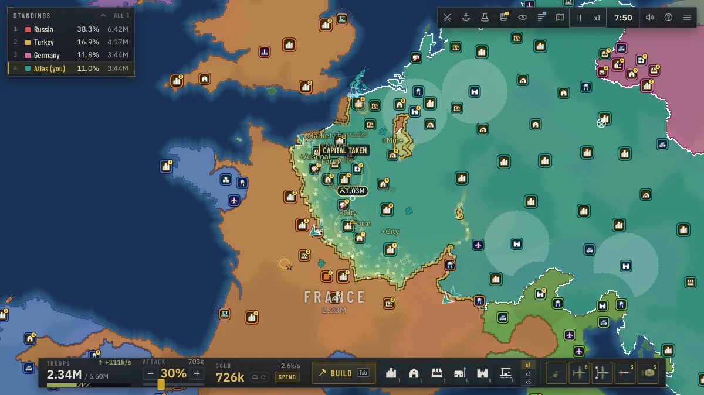
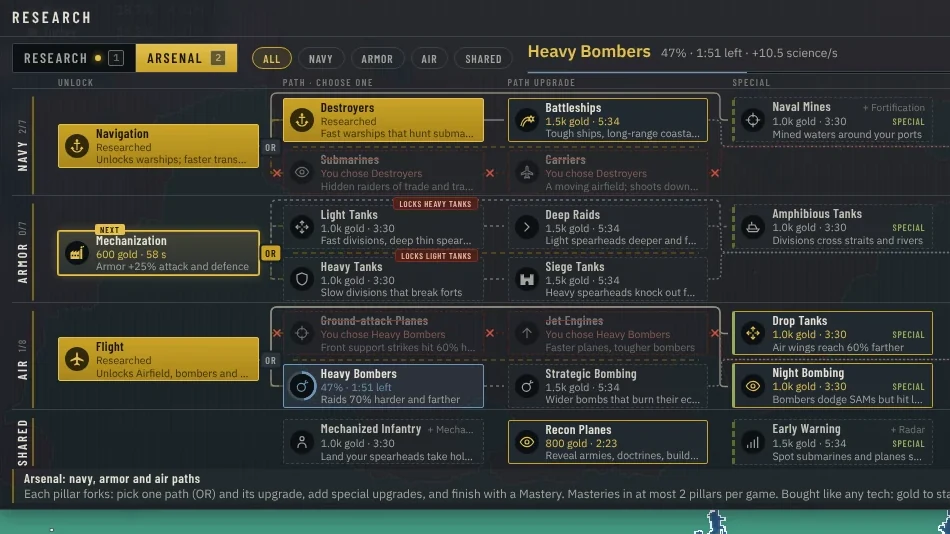
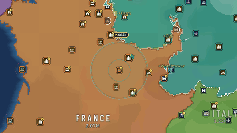
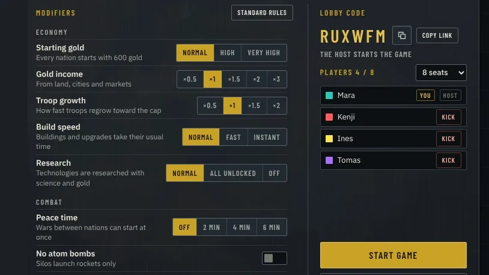
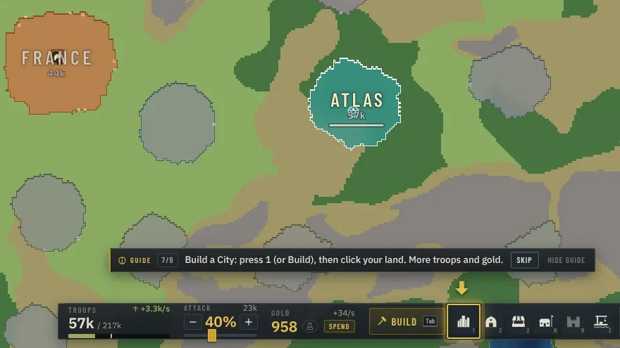
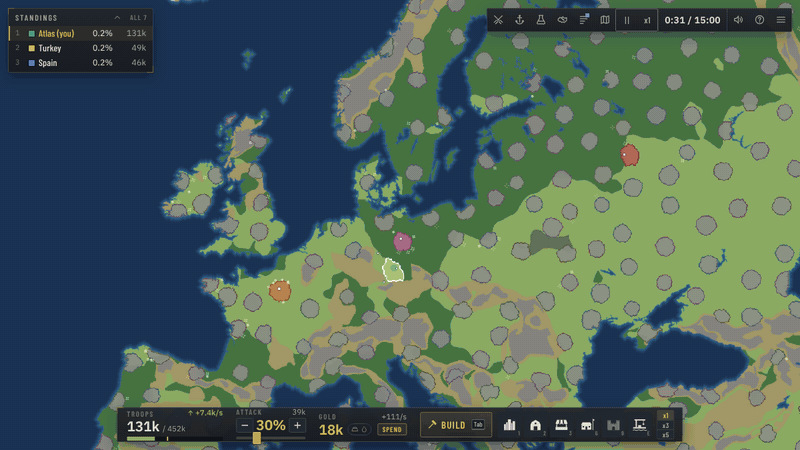
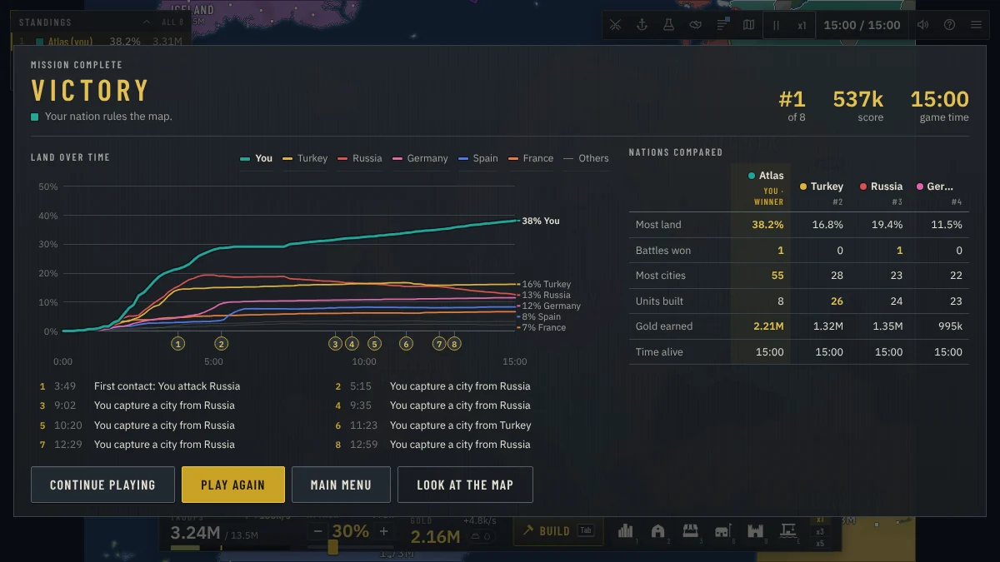

<div align="center">

<a href="https://frontline-atlas.onrender.com"></a>

<br>

<a href="https://frontline-atlas.onrender.com"></a>&nbsp;
<a href="https://doom956.github.io/FrontlineAtlas/"></a>

<sub>Free in your browser. No install, no account.</sub>

<br>

**Choose a target, not a tile.** Every border you share with it advances at once. Then win your way: with a navy, tank divisions, air wings, a wall of forts or a booming economy.



<sub>The front pushing into France at 2x speed.</sub>

</div>

<br>

## Features

<table>
<tr>
<td width="50%" valign="top">

<br><b>Whole fronts, one click</b>
<br>Pick who you attack. The shared border moves, faster the longer it is.
</td>
<td width="50%" valign="top">

<br><b>Arsenal paths</b>
<br>Fork your navy, armor and air. One path each per game, two masteries at most.
</td>
</tr>
</table>

<table>
<tr>
<td width="50%" valign="top">

<br><b>Strikes and atom bombs</b>
<br>Barrages, bombs, paradrops, rockets and nukes. SAM sites shoot them down.
</td>
<td width="50%" valign="top">

<br><b>12 real-world maps</b>
<br>World, Europe, Asia and nine more, or a generated continent or archipelago.
</td>
</tr>
</table>

<table>
<tr>
<td width="50%" valign="top">

<br><b>Online lobbies</b>
<br>Public games, or a private lobby with a 6-character code. AI fills the free seats.
</td>
<td width="50%" valign="top">

<br><b>Learn as you play</b>
<br>A 5-minute tutorial, then a small guide that explains each new thing once.
</td>
</tr>
</table>

<details>
<summary><b>Everything in the game</b></summary>
<br>

- **Three troop types.** Infantry, armor and artillery counter each other. Factories and Arsenals set your mix.
- **Terrain and supply.** Forest, hills, mountains, swamp, desert and tundra change defence and speed. Far fronts fight weaker.
- **17 buildings, levelled.** Cities, farms, markets, mines, forts, ports, labs, airfields, SAM sites, missile silos and more.
- **Research.** 48 techs in 5 tiers across two tabs. OR choices lock the other branch for good.
- **Seven doctrines.** From 5:00 pick a play style: Blitz, Fortress, Siege, Merchant, Naval, Air or Expansion. Nothing is ever forbidden.
- **Warships with stances.** Auto, hunt, escort, bombard or blockade.
- **Tank divisions.** Fast spearheads that survive, refit and gain veterancy. Encircled pockets collapse.
- **Air wings.** Support a front, bomb an enemy's income or hold the sky with fighters.
- **Diplomacy.** Alliances, gifts, embargoes, traitor penalties, and coalitions against a runaway leader.
- **AI nations and tribes.** Personalities, four difficulty levels, and hundreds of small tribes to absorb.
- **Fair online play.** A deterministic lockstep simulation: every browser computes the same game.

</details>

## How to play

1. Press **Single player**, pick a map and start. Click a land tile to place your capital.
2. Click land next to yours to expand. Click an enemy border to attack it.
3. Set **Attack %** with `[` and `]`. Keep spending: a full troop bar barely grows.
4. Press `Tab` to build (cities and farms first) and `T` for research.
5. At 5:00, press `Shift+D` and pick a doctrine. Click a nation in the standings to ally, gift or embargo.

New here? Press **Tutorial** on the title screen. In any game, `?` opens a searchable guide.

## Ways to win

| Path | How it carries a game |
|:--|:--|
| **Navy** | Warships bombard a coast to speed your landings, and blockades cut enemy trade. |
| **Armor** | Tank divisions punch deep spearheads and close pockets that then collapse. |
| **Air** | Air wings bomb ahead of your fronts and cut enemy income with raids. |
| **Land** | Forts hold the line, artillery breaks theirs, and the heartland defends itself. |
| **Economy** | Cities, markets and trade outgrow everyone. Gold buys mercenaries and war bonds. |

A game ends when one nation holds 75% of the land, is the last one standing, or leads on score when a time limit runs out. Teams win together.

<table>
<tr>
<td width="50%" valign="top">

<br><b>A whole game in eight seconds</b>
<br>Fifteen minutes on the Europe map, from the first spawn to the win.
</td>
<td width="50%" valign="top">

<br><b>Then the summary</b>
<br>Land over time, the key moments and every nation's numbers side by side.
</td>
</tr>
</table>

## Multiplayer

- **Public games.** Free for all, Teams, or Special with random modifiers. AI nations fill the free places.
- **Private lobbies.** The full single-player setup plus a seat count. Share the code or an invite link.
- **Spectators.** Watch a game with the whole map in view. A fallen player keeps watching.
- **Host pause.** Only a private game's host can pause. Public games never pause.
- **Reconnect.** A dropped connection rejoins and catches up by itself.

Every client runs the same simulation. The server only relays orders and compares state hashes.

<details>
<summary><b>Controls</b></summary>
<br>

| Input | Action |
|:--|:--|
| Left click | Attack neutral or enemy land; select your own tile; place a building in build mode |
| Right click (long-press on touch) | Radial menu: the likely action in the centre, the rest on a ring |
| Drag, `W` `A` `S` `D`, arrows | Pan the map |
| Mouse wheel | Zoom |
| `Tab` | Build menu |
| `1`-`9`, `0`, `Q` `E` `R` `H` `F` `G` `N` | Building hotkeys (hold Shift to place several) |
| `[` and `]` | Attack share down / up |
| `T` `U` `Y` `P` `J` `L` | Research, Army, Forces, Diplomacy, Events, Map key |
| `Shift+D` | Doctrine picker |
| `Shift+W` / `Shift+A` | Select every warship / tank division |
| `Z` `X` `K` `I` `O` | Strikes: barrage, bomb, paradrop, rocket, atom bomb |
| `B` / `V` / `M` | Supply overlay / resource overlay / minimap |
| `C` | Centre on your capital |
| `Space` | Pause (single player, or the host of a private game) |
| `+` and `-` | Game speed (single player) |
| `?` or `F1` | Help |
| `Esc` | Cancel or close |

</details>

<details>
<summary><b>Game setup: modes, presets and modifiers</b></summary>
<br>

Single player and the multiplayer lobby share one options model (`src/sim/setup.ts`). The simulation enforces every rule (`src/sim/rules.ts`), and the AI plays by them too.

- **Map:** Continents, Pangaea, Archipelago or Highlands in four sizes, or a real-world map.
- **Players:** AI nations (default 8) and tribes (Auto sizes them to the map's land).
- **Difficulty:** Easy, Normal, Hard or Brutal.
- **Mode:** free for all, or 2 to 6 teams. Teammates are allied all game and win together.
- **Presets:** Classic, Quick Conquest, Grand War, Island Hopping, Chaos (random modifiers).

| Group | Modifier | What it does |
|:--|:--|:--|
| Economy | Starting gold | Normal (600), High (5,000) or Very high (20,000) |
| Economy | Gold income | x0.5 to x3 |
| Economy | Troop growth | x0.5 to x2 |
| Economy | Build speed | Normal, Fast or Instant |
| Economy | Research | Normal, All unlocked or Off |
| Combat | Peace time | 2, 4 or 6 minutes without attacks between nations |
| Combat | No atom bombs / No air force / No warships / No SAM sites | Switches that part of the game off |
| Rules | Random starts | Every start is picked at random, yours too |
| Rules | Compact map | Half the width and height |
| Rules | No alliances | Teammates stay allied |
| Rules | Fast game | Double speed for income, growth, building, research and fronts |
| Rules | Time limit | 15, 30 or 60 minutes, then the highest score wins |
| Rules | Victory | The land share that wins: 60, 70, 75, 80 or 90% |

</details>

## Run it yourself

You need Node.js 22 or newer.

**Play locally**

```sh
npm install
npm run dev      # dev server plus the multiplayer server; open the printed URL
```

**Test and ship**

```sh
npm test         # unit tests (Vitest)
npm run build    # client (dist/index.html) and server; npm run typecheck checks types
npm start        # game and multiplayer server on http://localhost:8080
```

`dist/index.html` is one self-contained file. Open it from disk or put it on any static host. Friends on your network can join at `http://<your-ip>:8080`.

<details>
<summary><b>Server settings</b></summary>
<br>

All optional. Full list: [docs/MULTIPLAYER.md](docs/MULTIPLAYER.md).

| Variable | Default | Meaning |
|:--|:--|:--|
| `PORT` | 8080 | HTTP and WebSocket port |
| `HOST` | 0.0.0.0 | Listen address |
| `STATIC_DIR` | `dist` | Folder with the built client; empty serves no files |
| `PUBLIC_START_SECONDS` | 60 | Public lobby countdown |
| `PUBLIC_LOBBIES` | 1 | `0` turns public lobbies off |
| `MAX_CONNECTIONS_PER_IP` | 8 | Connections per address |
| `MAX_ROOMS` / `MAX_ROOMS_PER_IP` | 500 / 3 | Lobbies and games at once |
| `TRUST_PROXY`, `PROXY_HOPS`, `CLIENT_IP_HEADER` | auto | How the client address is read behind a proxy |
| `ALLOWED_ORIGINS` | any | Page origins allowed to open the WebSocket |

</details>

<details>
<summary><b>Deploy</b></summary>
<br>

A static copy (GitHub Pages) plays single player. The Node server also hosts online games. Free hosting on Render or Fly.io, how a static page finds a server (`?server=` or `VITE_SERVER_URL`) and every setting: [docs/MULTIPLAYER.md](docs/MULTIPLAYER.md).

</details>

<details>
<summary><b>Balance and profiling tools</b></summary>
<br>

These run without a browser.

```sh
# AI-only game: seed, minutes, map size, AI count, map type
npm run headless -- 1 30 medium 8 continents

# time per simulation system, tick-time percentiles, memory
npm run profile -- --size huge --ai 50 --tribes 300 --minutes 20

# many AI-only games in parallel: winners, game length, army mixes
npx vite-node scripts/batch.ts -- --sizes medium,large,world:world --seeds 8 --jobs 4
```

`npm run build && node tests/e2e/mp.e2e.mjs` runs the browser end-to-end test of online play (Playwright).

</details>

## Project structure

| Path | What lives there |
|:--|:--|
| `src/sim/` | Deterministic simulation: rules, combat, economy, AI, maps. No DOM, no `Math.random`. Balance numbers in `config.ts` |
| `src/client/` | Browser only: menu, renderer (WebGL2 + Canvas2D), HUD, input, audio |
| `src/net/` | Wire protocol and the WebSocket client |
| `src/maps/` | Baked real-world map data |
| `server/` | Multiplayer relay server (Node, `ws`): lobbies, turns, hash checks |
| `tests/` | Vitest unit tests and Playwright end-to-end tests |
| `scripts/` | Headless runs, profiling, balance batches, map baking |
| `docs/` | [Design](docs/DESIGN.md), [Maps](docs/MAPS.md), [Multiplayer](docs/MULTIPLAYER.md), [Audio](docs/AUDIO.md) |

The simulation only changes through `tick(state)` and `applyAction(state, playerId, action)`. The same seed and the same actions always give the same game. The AI uses the same action path as the player.

## Built with


## Roadmap and contributing

What is planned next, and what the balance checks still flag: [ROADMAP.md](ROADMAP.md). Past releases: [CHANGELOG.md](CHANGELOG.md). Want to help? Read [CONTRIBUTING.md](CONTRIBUTING.md).

## Credits

Real-world map data from [Natural Earth](https://www.naturalearthdata.com) (public domain). Fonts: Barlow Condensed and IBM Plex Sans, bundled through Fontsource. Data sources in detail: [docs/MAPS.md](docs/MAPS.md).

## License

[MIT](LICENSE) © 2026 Doom956

<br>

<div align="center">

<a href="https://frontline-atlas.onrender.com"></a>

<sub>Choose a target. Move the whole front.</sub>

</div>
