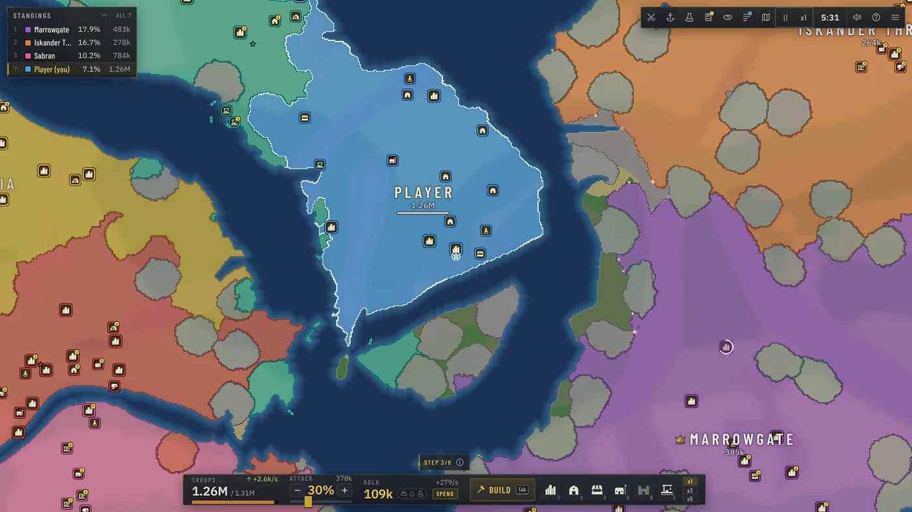
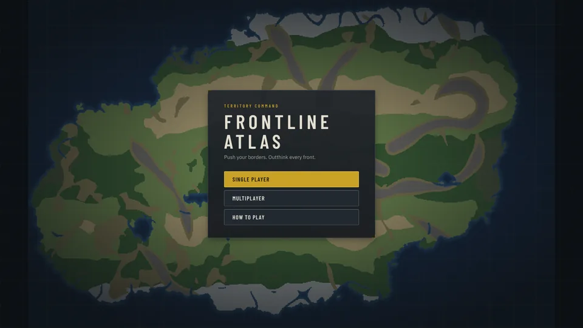
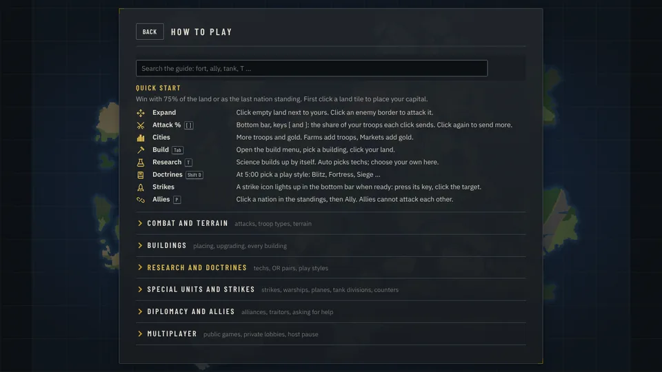
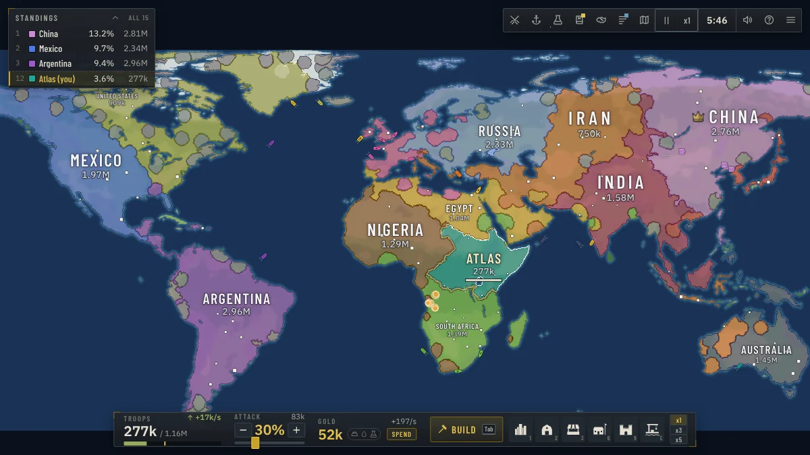
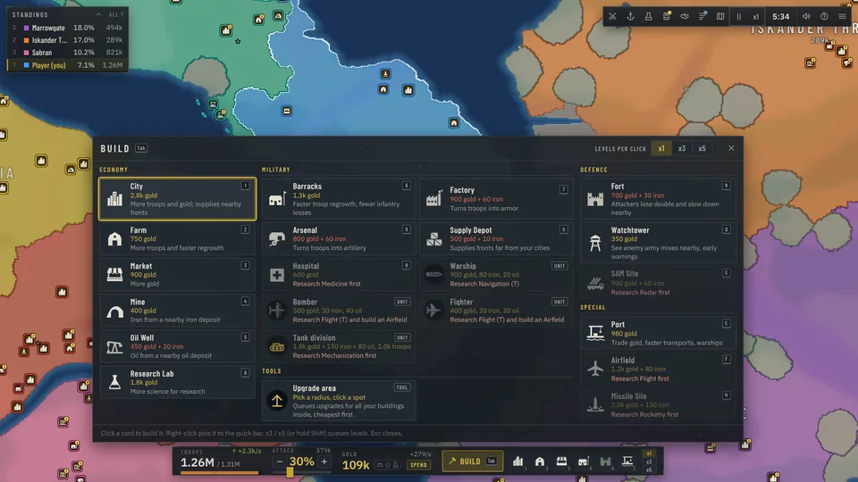
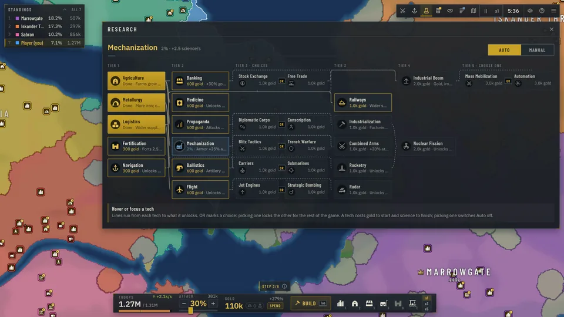
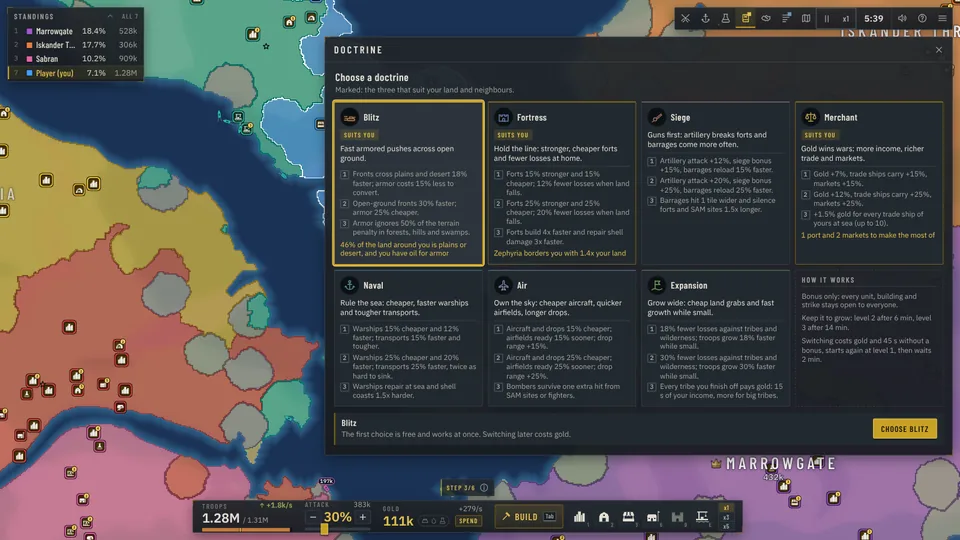

<div align="center">

# Frontline Atlas

**Push your borders. Outthink every front.**
A territory-control strategy game that runs in your browser. Single player needs nothing but the page.

[](https://frontline-atlas.onrender.com)
[](https://doom956.github.io/FrontlineAtlas/)




</div>

> **Play now** has single player and online games. **Fast page** loads quicker and plays single player offline;
> for online games it needs the server (see [Multiplayer](#multiplayer)).

## Screenshots

| | |
|:--|:--|
| <br>**Title screen** | <br>**How to play:** quick start, search, collapsible sections |
| <br>**Real-world map** with countries as AI nations | <br>**Build menu:** every building, unit and tool |
| <br>**Research tree** with OR choices | <br>**Doctrines** from minute 5 |

## Features

- **One click, one front.** You pick who you attack, not a point: the whole shared border advances, faster the longer it is.
- **Three troop types.** Infantry, armor and artillery counter each other; Factories and Arsenals set your mix.
- **Terrain and supply.** Forests, hills, mountains, swamps, deserts and tundra change defence and speed. Far fronts fight weaker.
- **17 buildings, levelled.** Cities, farms, markets, mines, forts, ports, labs, airfields, SAM sites, missile silos and more.
- **A research tree.** 30 techs in 5 tiers, with OR choices that lock the other branch for good.
- **Seven doctrines.** From 5:00 pick a play style (Blitz, Fortress, Siege, Merchant, Naval, Air, Expansion). Nothing is ever forbidden.
- **Sea, air and missiles.** Transports, warships, bombers, fighters, paratroopers, artillery barrages, rockets and atom bombs.
- **Tank divisions.** Punch a fast spearhead through enemy land; mountains and forts stall it.
- **Diplomacy.** Alliances, gifts, embargoes, traitor penalties, and coalitions against a runaway leader.
- **Real-world maps.** 12 of them (World, Europe, Asia, Africa, the Americas ...) or generated continents and islands.
- **AI nations and tribes.** Personalities and difficulty levels, plus hundreds of weak tribes to conquer.
- **Online play.** Public games, private lobbies with a code, spectators, and a deterministic lockstep simulation.

## How to play

1. Press **Single player**, pick a map and start. Click a land tile to place your capital.
2. Click land next to yours to expand. Click an enemy border to attack it.
3. **ATTACK %** (keys `[` and `]`) is the share of your troops each click sends. Keep spending: a full troop bar barely grows.
4. Press `Tab` to build (cities and farms first), `T` for research, `Shift+D` for a doctrine at 5:00.
5. Click a nation in the standings to ally, gift or embargo. Hold 75% of the land, or be the last nation standing.

The in-game **How to play** page (title screen, or `?` in a game) has a quick start and a searchable guide.

## Multiplayer

- **Public games.** Free for all, Teams and Special (random modifiers). Join one: it starts when its countdown ends; AI nations fill the free places.
- **Private lobbies.** The single-player setup plus a seat count. Share the 6-character code or invite link; friends press **Join**.
- **Host pause.** Only the host of a private game can pause. Public games never pause, and there is no game speed online.
- **Watch** a game as a spectator, and reconnect after a dropped connection: the game catches up by itself.

<details>
<summary><b>Controls</b></summary>

| Input | Action |
|-------|--------|
| Left click | Attack neutral or enemy land; select your own tile; place a building in build mode |
| Right click (long-press on touch) | Radial menu: the likely action in the centre, the rest on a ring |
| Drag, `W` `A` `S` `D`, arrows | Pan the map |
| Mouse wheel | Zoom |
| `Tab` | Build menu |
| `1`-`9`, `0`, `Q` `E` `R` `H` `F` `G` `N` | Building hotkeys (hold Shift to place several) |
| `[` and `]` | Attack share -/+ |
| `T` `U` `Y` `P` `J` `L` | Research, Army, Forces, Diplomacy, Events, Map key |
| `Shift+D` | Doctrine picker |
| `Shift+W` / `Shift+A` | Select every warship / tank division |
| `Z` `X` `K` `I` `O` | Strikes: barrage, bomb, paradrop, rocket, atom bomb |
| `B` / `V` / `M` | Supply overlay / resource overlay / minimap |
| `C` | Centre on your capital |
| `Space` | Pause (single player, or the host of a private game) |
| `+` and `-` | Game speed (single player) |
| `?` or `F1` | Help |
| `Esc` | Cancel or close |

</details>

<details>
<summary><b>Game setup: modes, presets and modifiers</b></summary>

The setup screen (single player) and the multiplayer lobby share one options model (`src/sim/setup.ts`). The sim
enforces every rule (`src/sim/rules.ts`) and the AI plays by it too.

- **Map:** Continents, Pangaea, Archipelago or Highlands in four sizes, or a real-world map.
- **Players:** AI nations (default 8) and tribes (Auto = by the map's land).
- **Mode:** free for all, or 2 to 6 teams. Teammates are allied all game and win together.
- **Presets:** Classic, Quick Conquest, Grand War, Island Hopping, Chaos (random modifiers).

| Group | Modifier | What it does |
|---|---|---|
| Economy | Starting gold | Normal (600), High (5,000) or Very high (20,000) |
| Economy | Gold income | x0.5 to x3 |
| Economy | Troop growth | x0.5 to x2 |
| Economy | Build speed | Normal, Fast or Instant |
| Economy | Research | Normal, All unlocked or Off |
| Combat | Peace time | 2, 4 or 6 minutes without attacks between nations |
| Combat | No atom bombs / No air force / No warships / No SAM sites | switch that part of the game off |
| Rules | Random starts | every start is picked at random, yours too |
| Rules | Compact map | half the width and height |
| Rules | No alliances | teammates stay allied |
| Rules | Fast game | double speed for income, growth, building, research and fronts |
| Rules | Time limit | 15, 30 or 60 minutes, then the highest score wins |
| Rules | Victory | the land share that wins: 60, 70, 75, 80 or 90% |

</details>

## Run it yourself

You need Node.js 22 or newer.

```sh
npm install      # install dependencies
npm run dev      # dev server (Vite) plus the multiplayer server; open the printed URL
npm test         # unit tests (Vitest)
npm run build    # type-check and build the client (dist/index.html) and the server
npm start        # serve the game and the multiplayer server on http://localhost:8080
```

`dist/index.html` is one self-contained file: open it from disk or put it on any static host. Friends on your
network can join `http://<your-ip>:8080`.

<details>
<summary><b>Server settings (environment variables)</b></summary>

All optional. Full list and meanings: [docs/MULTIPLAYER.md](docs/MULTIPLAYER.md).

| Variable | Default | Meaning |
|----------|---------|---------|
| `PORT` | 8080 | HTTP and WebSocket port |
| `HOST` | 0.0.0.0 | listen address |
| `STATIC_DIR` | `dist` | folder with the built client; empty = serve no files |
| `PUBLIC_START_SECONDS` | 60 | public lobby countdown |
| `PUBLIC_LOBBIES` | 1 | `0` = no public lobbies |
| `MAX_CONNECTIONS_PER_IP` | 8 | connections per address |
| `MAX_ROOMS` / `MAX_ROOMS_PER_IP` | 500 / 3 | lobbies and games at once |
| `TRUST_PROXY`, `PROXY_HOPS`, `CLIENT_IP_HEADER` | auto | how the client address is read behind a proxy |
| `ALLOWED_ORIGINS` | any | page origins allowed to open the WebSocket |

</details>

<details>
<summary><b>Balance and profiling tools</b></summary>

These run without a browser:

```sh
# AI-only game: seed, minutes, map size, AI count, map type
npm run headless -- 1 30 medium 8 continents

# time per simulation system, tick-time percentiles, memory
npm run profile -- --size huge --ai 50 --tribes 300 --minutes 20

# many AI-only games in parallel: winners, game length, army mixes
npx vite-node scripts/batch.ts -- --sizes medium,large,world:world --seeds 8 --jobs 4
```

`npm run build && node tests/e2e/mp.e2e.mjs` runs the browser end-to-end test of online play (Playwright).

</details>

## Deploy

A static copy (GitHub Pages) plays single player; the Node server also hosts online games. Free hosting on Render
or Fly.io, how a static page finds a server (`?server=` or `VITE_SERVER_URL`) and every server setting:
[docs/MULTIPLAYER.md](docs/MULTIPLAYER.md).

## Project structure

| Path | What |
|------|------|
| `src/sim/` | Deterministic simulation: no DOM, no `Math.random`. Rules, combat, economy, AI, maps. All balance numbers in `config.ts` |
| `src/client/` | Browser only: menu, renderer (WebGL2 + Canvas2D), HUD, input, audio |
| `src/net/` | Wire protocol and the WebSocket client |
| `src/maps/` | Baked real-world map data |
| `server/` | The multiplayer relay server (Node, `ws`): lobbies, turns, hash votes |
| `tests/` | Vitest unit tests and a Playwright end-to-end test |
| `scripts/` | Headless runs, profiling, balance batches, map baking |
| `docs/` | [DESIGN](docs/DESIGN.md), [MAPS](docs/MAPS.md), [MULTIPLAYER](docs/MULTIPLAYER.md), [AUDIO](docs/AUDIO.md) |

The simulation only changes through `tick(state)` and `applyAction(state, playerId, action)`: the same seed and the
same actions always give the same game. The client reads the state every frame and sends actions; the AI uses the
same action path as the player.

## Credits

Real-world map data: [Natural Earth](https://www.naturalearthdata.com) (public domain). Fonts: Barlow Condensed and
IBM Plex Sans, bundled through Fontsource. Details on data sources: [docs/MAPS.md](docs/MAPS.md).

## License

MIT, see `package.json`.
